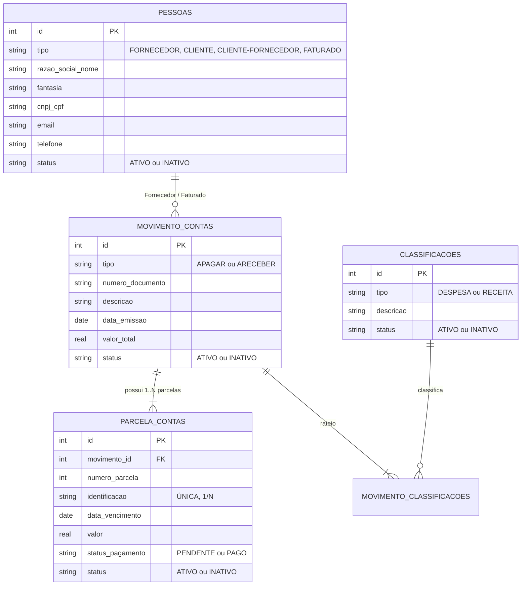

# FINEASY - Sistema Administrativo-Financeiro & IA Fiscal
## UniRV - Prática de Engenharia de Software (6º Período)
### Projeto Administrativo-Financeiro - Avaliação N2 (1ª e 2ª Etapas Concluídas)


**FINEASY** é um sistema Web completo que integra extração inteligente de dados de Notas Fiscais (DANFE / Contas a Pagar) utilizando LLMs (Google Gemini) e um ecossistema completo de gestão **Administrativo-Financeira** conforme os padrões acadêmicos da Universidade de Rio Verde (UniRV).

---

## 🌐 Ambientes Hospedados em Produção

- **Frontend (Cloudflare Pages)**: [https://fineasyaiproject.pages.dev](https://fineasyaiproject.pages.dev)
- **Backend API (Render)**: [https://fineasy.onrender.com](https://fineasy.onrender.com)
- **Repositório GitHub**: [https://github.com/UmLucasApenas-lab/Projeto-Administrativo---Disciplina-PRATICA-DE-ENGENHARIA-DE-SOFT](https://github.com/UmLucasApenas-lab/Projeto-Administrativo---Disciplina-PRATICA-DE-ENGENHARIA-DE-SOFT)

---

## 🚀 Funcionalidades da 2ª Etapa Implementadas

### 1. Análise Automática pós-extração da Nota Fiscal (Páginas 1 e 2 do PDF)
- Ao extrair qualquer nota fiscal, o backend cruza os dados com o Banco de Dados em tempo real:
  - **FORNECEDOR**: Consulta por CNPJ ou Razão Social e informa na tela se `EXISTE – ID: XX` ou `NÃO EXISTE`.
  - **FATURADO**: Consulta por CPF ou Nome Completo e informa se `EXISTE – ID: XX` ou `NÃO EXISTE`.
  - **DESPESA**: Consulta a descrição da classificação e informa se `EXISTE – ID: XX` ou `NÃO EXISTE`.
- **Botão de Lançamento no Sistema Financeiro**:
  1. Cria o novo Fornecedor caso não exista (`status = 'ATIVO'`);
  2. Cria o novo Faturado caso não exista (`status = 'ATIVO'`);
  3. Cria a nova Despesa caso não exista (`status = 'ATIVO'`);
  4. Cria o registro do Movimento em `movimento_contas` (Tipo: `APAGAR`) e suas respectivas parcelas em `parcela_contas`;
  5. Notifica o usuário: **"REGISTRO FOI LANÇADO COM SUCESSO."**
  6. Atualiza imediatamente os badges na tela para `EXISTE – ID: XX`.

### 2. Módulos Administrativos (CRUDs)
- **Manter Pessoas**: Gerenciamento de Fornecedores, Clientes e Faturados.
- **Manter Classificação**: Cadastro de Tipos de Despesas e Tipos de Receitas.
- **Registrar Contas**: Contas a Pagar e a Receber com rateio de despesas e suporte a múltiplas parcelas com datas de vencimento distintas.

### 3. Regras de Negócio e Recomendações de Layout UniRV Atendidas
- **Exclusão Lógica Obrigatória**: Nenhum registro cadastral pode ser excluído fisicamente (`DELETE`). Ao excluir, o campo `status` é alterado para `'INATIVO'`.
- **Reativação**: Suporte a reativar qualquer registro inativo, restaurando-o para `status = 'ATIVO'`.
- **Tabela Vazia Inicialmente**: As tabelas de listagem iniciam vazias por padrão para máxima performance.
- **Botão "TODOS"**: Carrega todos os registros cadastrados com `status = 'ATIVO'`.
- **Busca Multi-Termo**: O campo de busca pesquisa simultaneamente por Nome/Razão Social, Documento (CNPJ/CPF formatado ou limpo), Telefone e E-mail.
- **Indexação por Coluna**: Ordenação alfabética e numérica ao clicar nos cabeçalhos das colunas (`<th>`).
- **Campos Ocultos**: No CREATE e UPDATE, o campo `status` permanece oculto (sendo gravado como `ATIVO` no cadastro).

---

## 🛠️ Tecnologias e Arquitetura

- **Backend**: Python 3 com microframework Flask.
- **Banco de Dados**: SQLite3 com integridade referencial (`PRAGMA foreign_keys = ON`), transações ACID e soft delete.
- **Frontend**: Aplicação SPA moderna em Vanilla JS (ES6+), HTML5 e CSS3 responsivo com suporte a temas Claro e Escuro.
- **Segurança**: Autenticação via tokens JWT (`PyJWT`) e senhas com hash criptográfico (`werkzeug.security`).
- **Processamento Fiscal & IA**: Google Gemini API (`google-genai`) + Engine Heurístico SEFAZ DANFE.

---

## 📊 Modelo do Banco de Dados Relacional



---

## 🧪 Testes Automatizados

O projeto conta com uma suíte abrangente de testes unitários e de integração de ponta a ponta (E2E):

```bash
python -m unittest discover -s tests -p "test_*.py" -v
```

### Cobertura dos Testes:
1. `tests/test_database_etapa2.py`: Criação de tabelas relacionais, integridade referencial, soft-delete e reativação.
2. `tests/test_api_crud_basico.py`: Endpoints REST de Pessoas e Classificações, regras de busca e layout UniRV.
3. `tests/test_analise_e_lancamento.py`: Motor de análise e lançamento automático transacional (Páginas 1 e 2 do PDF).
4. `tests/test_api_contas.py`: Endpoints de Contas com rateio de despesas e múltiplas parcelas com datas distintas.
5. `tests/test_fluxo_completo_e2e.py`: Ciclo de vida completo (extração -> análise inicial NÃO EXISTE -> lançamento -> re-análise EXISTE – ID: XX -> consulta nas tabelas -> exclusão lógica e reativação).

---

## 💻 Como Executar Localmente

### 1. Clonar o repositório e instalar dependências
```bash
git clone https://github.com/UmLucasApenas-lab/Projeto-Administrativo---Disciplina-PRATICA-DE-ENGENHARIA-DE-SOFT.git
cd Projeto-Administrativo---Disciplina-PRATICA-DE-ENGENHARIA-DE-SOFT
python -m pip install -r requirements.txt
```

### 2. Iniciar a aplicação Flask
```bash
python app.py
```
Acesse no navegador: **[http://localhost:5000](http://localhost:5000)**

### Credenciais Padrão de Acesso:
- **E-mail**: `admin@unirv.edu.br`
- **Senha**: `admin123`
*(Você também pode criar uma nova conta na tela de registro)*
